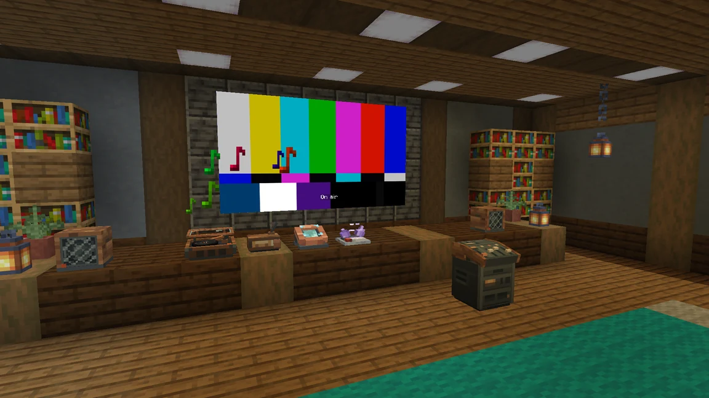

# NetMusicCanPlayBili

[简体中文](README.md) · English

Burn a Bilibili video onto a NetMusic CD and play it in Minecraft. Place a projector where you want the picture, put a speaker on either side of the room, and drop the disc onto the turntable. This NeoForge add-on also plays Bilibili live streams and lets map makers tie music to places in the world.

## Set up a screening room

1. Enter a BV ID, an av ID, or a Bilibili video URL in NetMusic’s CD Burner. For a multi-part video, choose the part to burn. If the video requires an account, open the Bilibili login on a NetMusic Computer and scan the QR code with the Bilibili mobile app.
2. Right-click a Modern Turntable with the recorded Music CD to start playback. Sneak and right-click to pause, seek, or change the repeat setting. Hoppers can change discs, redstone can control playback, and a comparator can read playback progress.
3. Hold a Video Projector and right-click the turntable **before placing the projector**. It remembers the source when you put it down. Link a Lyric Projector or a Speaker the same way. Right-click each placed speaker to assign a channel before listening.
4. For live video, enter a Bilibili room ID in a Live Streamer and start playback. Link a video projector and speakers to the streamer. For a custom layout, link a Control Console to the turntable or streamer and use its editor to position screens, captions, and sound sources.

## Take the music with you

| Item | What you can do |
| --- | --- |
| MP4 | Carry up to 18 CDs. In your inventory, pick up a disc and click the MP4 to load it. Hold the player and right-click to choose a track, read subtitles, or watch in landscape. |
| Pad | Drag tracks onto a map and choose where each one plays. Keep the editable original and give other players a locked copy for a sound walk or an adventure map. |
| Media Management Tool | Link the turntable, MP4, or Pad to Invisible Headphones or Cat Ear Headphones for private listening. Link Holographic Glasses to see video in your own field of view. The frames are hidden when worn. |

All six blocks and six handheld or wearable items have crafting table recipes. Server operators can manage an allowlist and review reported sources. [Recipe reference (Chinese)](docs/play-guide.md#合成速查) · [Player guide (Chinese)](docs/play-guide.md) · [Server commands (Chinese)](docs/play-guide.md#服务器管理员附录)

## Installation

- Use **Minecraft Java Edition 26.1.2**, **Java 25**, and **NeoForge**. The project is built and tested against NeoForge 26.1.2.76.
- Put this add-on and **NetMusic 1.5.1 or later for the same Minecraft version** in the `mods` folder. On a multiplayer server, install matching copies on the server and on every client. [Download the add-on](https://github.com/zhongbai2333/NetMusicCanPlayBili/releases) · [Download NetMusic](https://modrinth.com/mod/net-music)
- Optionally install Curios to keep your helmet while wearing headphones or glasses in a head accessory slot. Servers using AreaControl can isolate public audio at region boundaries. [Curios](https://modrinth.com/mod/curios) · [AreaControl](https://github.com/teaconmc/AreaControl)

The JAR includes native decoders for x86_64 and ARM64 on Windows, macOS, and Linux. H.264 supports software decoding. AV1 requires a compatible GPU and driver. On Linux, the bundle also needs `libva.so.2`, `libva-drm.so.2`, `libdrm.so.2`, and glibc 2.35 or newer on x86_64 or 2.38 or newer on ARM64. Bilibili login credentials are encrypted locally in the game directory. [Media support and Linux requirements (Chinese)](docs/release-native-capabilities.md) · [Privacy and configuration (Chinese)](docs/play-guide.md#配置与隐私)

## Development and license

With JDK 25, run `./gradlew build platformTest` from the repository root. On Windows, use `gradlew.bat build platformTest`. The mod JAR is written to `build/libs/`. [Development guide (Chinese)](docs/development.md) · [Blockbench source models](design/blockbench) · [Report an issue](https://github.com/zhongbai2333/NetMusicCanPlayBili/issues)

The project source is licensed under MIT. Bundled FFmpeg libraries and the ZXing QR encoder retain their own licenses. [MIT license](LICENSE) · [Third-party notices](src/main/resources/META-INF/THIRD-PARTY-NOTICES.md)
