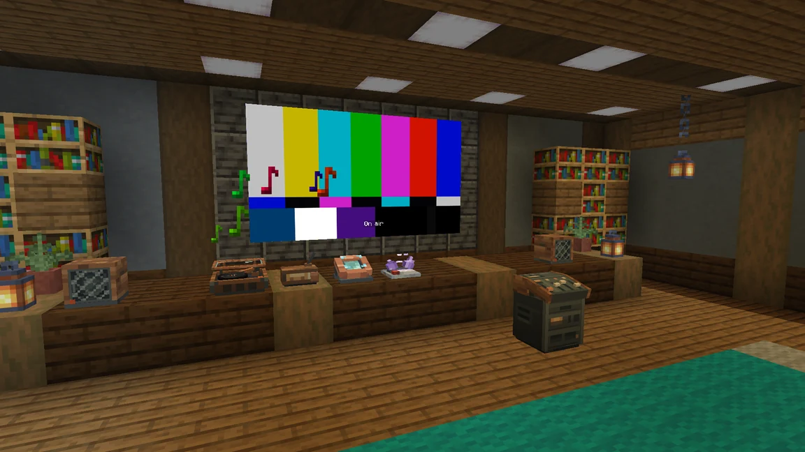

# NetMusicCanPlayBili

简体中文 · [English](README.en.md)

把 Bilibili 视频刻进一张 NetMusic 唱片，放上唱片机，再把画面、歌词和声音送到房间里的不同位置。这个 NeoForge 附属模组也能播放 B 站直播。如果你在做冒险地图，还可以用 Pad 给沿途的地点配乐。

## 搭一间放映室

1. 在 NetMusic 的唱片刻录机里输入 BV 号、av 号或视频链接。多 P 视频可以选择分 P。需要登录时，在 NetMusic 电脑上打开「B站登录」，用手机客户端扫码。
2. 手持刻好的音乐唱片，右键现代化唱片机开始播放。潜行并右键打开播放控制。唱片机也能与漏斗、红石信号和比较器配合使用。
3. 主手拿着视频投影仪，右键唱片机记录音源，再把投影仪放到想要的位置。歌词投影仪和音响也这样绑定。放下音响后，右键选择声道才会出声。
4. 想看直播时，在直播机里输入房间号并开始播放，再用同样的方法连接视频投影仪和音响。需要自行安排屏幕、字幕和空间音源时，可以把中控台绑定到唱片机或直播机，在编辑器里布置。

## 把音乐带走

| 设备 | 用法 |
| --- | --- |
| MP4 | 装入最多 18 张唱片，手持右键打开播放列表，切歌、看字幕或横屏播放视频。 |
| Pad | 在地图上放置媒体点位，设定触发半径与方式。把锁定的 Pad 副本交给其他玩家，他们便能沿着你的路线收听。 |
| 媒体管理工具、耳机和全息眼镜 | 用工具把隐形耳机或猫耳无线耳机绑定到唱片机、MP4 或 Pad，耳机声音只有佩戴者能听见。全息眼镜可在佩戴者的视野中显示绑定的视频，戴上后镜框不可见。 |

六个方块和六件随身物品都有工作台配方。服务器管理员可管理媒体链接白名单，并查看玩家举报的音源。[合成速查](docs/play-guide.md#合成速查) · [游玩指南](docs/play-guide.md) · [服务器管理员附录](docs/play-guide.md#服务器管理员附录)

## 安装

使用 **Minecraft Java 版 26.1.2、Java 25 和 NeoForge**。本项目的构建与验证基线是 NeoForge 26.1.2.76。把本模组和适用于同一游戏版本的 **NetMusic 1.5.1 或更高版本**放入 `mods`。多人游戏需要在客户端和服务端都安装这两个模组。[下载模组](https://github.com/zhongbai2333/NetMusicCanPlayBili/releases) · [下载 NetMusic](https://modrinth.com/mod/net-music)

Curios 可让耳机和眼镜占用头部饰品槽，给头盔留出位置。安装 AreaControl 的服务器还可以利用区域边界隔离公共声音。[Curios](https://modrinth.com/mod/curios) · [AreaControl](https://github.com/teaconmc/AreaControl)

模组内置 Linux、macOS 和 Windows 的 x86_64 与 ARM64 解码库。H.264 支持软件解码，AV1 需要兼容的硬件和驱动。Linux 用户请同时核对系统库要求。Bilibili 登录凭据保存在游戏目录下的本机加密凭据库中。[媒体能力与 Linux 要求](docs/release-native-capabilities.md) · [配置与隐私](docs/play-guide.md#配置与隐私)

## 开发与许可

使用 JDK 25，在仓库根目录运行 `./gradlew build platformTest`。Windows 使用 `gradlew.bat build platformTest`。模组 JAR 位于 `build/libs/`。[开发说明](docs/development.md) · [文档索引](docs/README.md) · [Blockbench 源模型](design/blockbench) · [反馈问题](https://github.com/zhongbai2333/NetMusicCanPlayBili/issues)

项目源码使用 MIT 许可。随包的 FFmpeg 库和 ZXing 二维码编码组件保留各自的许可。[MIT](LICENSE) · [第三方声明](src/main/resources/META-INF/THIRD-PARTY-NOTICES.md)
